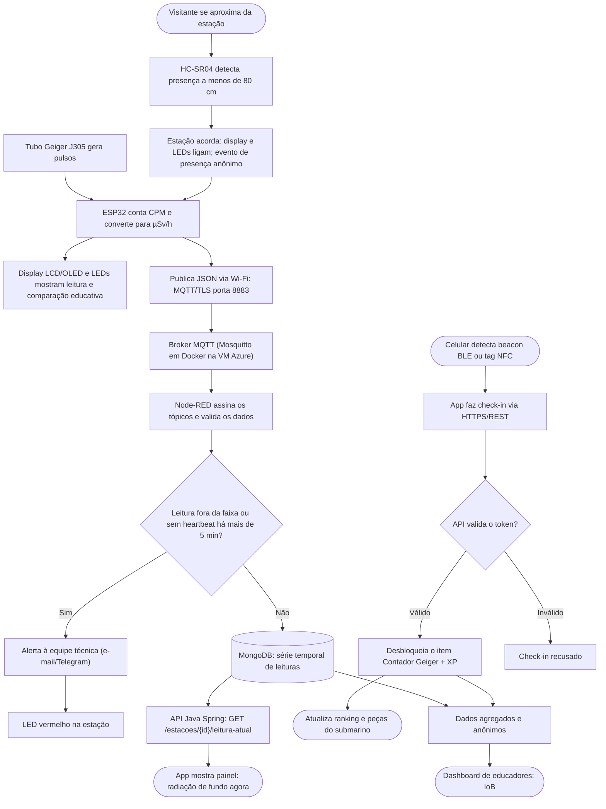
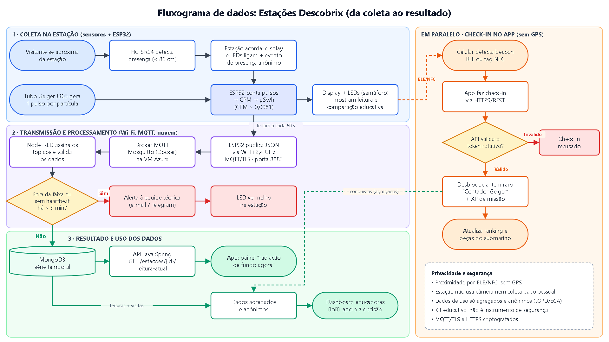
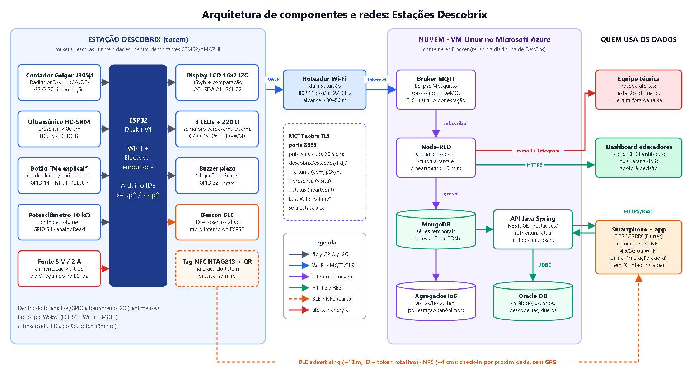

# Estações Descobrix: IoT e Redes no Descobrix

Disciplina: Disruptive Architectures: IoT, IoB & Generative AI (Prof. Renan Rodrigues Mendes)
Projeto: Descobrix, FIAP Challenge 2026 (CTMSP / Marinha do Brasil / AMAZUL)
Entrega: Sprint 1, proposta conceitual de IoT e Redes

| Integrante | RM |
|---|---|
| Julia Valerio Guimarães da Silva | 568275 |
| Rhayssa Graziano Bernardes e Rocha Ferreira | 567549 |
| Ruan Lima da Silva | 566719 |

Neste repositório estão a descrição da ideia, os componentes, a comunicação entre eles e o fluxograma. As imagens ficam na pasta `docs/`.

---

## 1. Descrição

### 1.1 O problema

A tecnologia nuclear está na medicina (tomografia, radioterapia), na indústria (detector de fumaça, inspeção de solda), na agricultura (irradiação de alimentos), na pesquisa e na geração de energia. Mesmo assim, muita gente só associa o assunto a acidente e arma. O Challenge pede uma solução digital, interativa e fácil de acessar, que aproxime a sociedade dessa tecnologia e mostre onde ela ajuda.

### 1.2 O app Descobrix

O Descobrix é um app mobile feito em Flutter, que mistura a ideia do Pokémon GO com a do Perguntados:

- O usuário aponta a câmera para objetos do dia a dia do catálogo (notebook, detector de fumaça, lâmpada LED, tomógrafo, painel solar).
- Cada objeto reconhecido libera uma ficha com a relação dele com a tecnologia nuclear. As fichas ficam numa coleção, como uma Pokédex.
- Com o que aprendeu, o usuário joga duelos de perguntas com amigos. A entrada é por convite com link, sem chat e sem jogadores aleatórios.
- Pontos e ranking liberam peças para montar um submarino 2D.
- Em uma versão futura, um mapa de pontos de interesse (museus, universidades, centros de pesquisa) dá XP extra.

O documento de compliance registra um limite: a câmera do celular não mede radiação. Reconhecer um objeto não prova que ele seja radioativo, então o app sozinho não consegue mostrar um dado real de radiação.

### 1.3 Onde entram IoT e Redes

Nossa proposta são as Estações Descobrix, totens com sensores reais. Elas são uma extensão futura do app e não fazem parte do MVP. Ficariam em museus de ciência, escolas, universidades e no centro de visitantes do CTMSP/AMAZUL, os mesmos tipos de lugar previstos no mapa do app.

Cada estação mede a radiação natural do ambiente com um contador Geiger e envia a leitura para o app. Assim a frase do kick-off, "a radiação está em toda parte, convivemos com ela", deixa de ser só texto e passa a ser algo que o visitante vê e ouve.

| Onde IoT/Redes se aplica | Necessidade que atende |
|---|---|
| Medição da radiação natural (Geiger + ESP32) | A câmera não mede radiação, a estação mede. O usuário vê um valor real, lido por um instrumento. |
| Detecção de presença (HC-SR04) | A estação liga quando alguém chega perto e conta visitas sem câmera e sem dado pessoal. |
| Check-in por proximidade (beacon BLE e tag NFC) | Confirma que a pessoa está na estação sem usar GPS (cuidado com crianças e adolescentes: LGPD, ECA, ECA Digital). O NFC também ajuda quem tem dificuldade de mirar a câmera. |
| Envio das leituras (Wi-Fi + MQTT) | Leva o dado da estação até o app, a cada minuto. |
| Monitoramento (heartbeat e alertas) | A equipe técnica descobre quando uma estação caiu ou quando uma leitura parece errada. |
| Dados agregados de uso (IoB) | Educadores veem quais exposições e conteúdos engajam mais e onde vale instalar novas estações. |

---

## 2. Componentes

Partimos do que vimos nas aulas com o Arduino UNO: LED com resistor, botão com `INPUT_PULLUP`, potenciômetro com `analogRead`, `map()` e PWM, sensor ultrassônico e o semáforo. Trocamos o UNO pelo ESP32, que usa a mesma Arduino IDE (com `setup()` e `loop()`), mas já vem com Wi-Fi e Bluetooth. O UNO não tem rede.

| # | Componente | O que faz | Onde fica | Ligação (conceitual) |
|---|---|---|---|---|
| 1 | ESP32 DevKit V1 | É o cérebro. Lê os sensores, calcula a radiação, controla display, LEDs e buzzer, publica os dados por Wi-Fi/MQTT e emite o beacon BLE. | Dentro do totem | 5 V pelo USB (o regulador interno gera 3,3 V) |
| 2 | Contador Geiger RadiationD-v1.1 (CAJOE) com tubo J305β | Cada partícula detectada gera um pulso. O ESP32 lê o pulso por interrupção, como se fosse um botão. Somando os pulsos de 1 minuto, ele obtém o CPM (contagens por minuto) e converte para µSv/h pelo fator do tubo (cerca de 0,0081, que precisa de calibração). | Topo do totem, atrás de uma grade | VIN → 5 V, GND → GND, VOUT → GPIO 27 |
| 3 | Sensor ultrassônico HC-SR04 | Mede a distância. Abaixo de 80 cm, acorda o display e os LEDs e conta uma visita anônima. | Frente do totem, na altura do peito | TRIG → GPIO 5, ECHO → GPIO 18 (com divisor de tensão, porque o ESP32 trabalha em 3,3 V) |
| 4 | 3 LEDs (verde, amarelo, vermelho) com resistores de 220 Ω | Semáforo de comparação. Verde: dentro da faixa típica do local. Amarelo: acima da média da estação, serve como curiosidade e conferência. Vermelho: fora do esperado, é um alerta técnico (possível defeito). Valor normal nunca aparece como perigo. | Painel frontal | GPIO 25, 26 e 33 |
| 5 | Buzzer | Faz o clique do Geiger a cada partícula, no modo demonstração. | Interno, com saída de som | GPIO 32 (PWM) |
| 6 | Botão "Me explica!" | Liga o modo demonstração e troca as curiosidades no display. | Painel frontal | GPIO 14 com `INPUT_PULLUP` |
| 7 | Potenciômetro 10 kΩ | Ajusta o brilho dos LEDs e o volume do buzzer (`analogRead` → `map()` → PWM). | Painel frontal | Cursor → GPIO 34 |
| 8 | Display LCD 16x2 com I2C (ou OLED) | Mostra o valor em µSv/h, uma comparação (voo, raio-X de tórax, banana) e a instrução para abrir o app. | Painel frontal | SDA → GPIO 21, SCL → GPIO 22 |
| 9 | Beacon BLE (rádio do próprio ESP32) | Anuncia o ID da estação com um token que muda de tempos em tempos, para o check-in sem GPS. | Dentro do ESP32 | BLE embutido |
| 10 | Tag NFC NTAG213 e QR code | Outras formas de check-in: aproximar o celular (cerca de 4 cm) ou ler o QR code. | Placa de identificação do totem | Passiva, sem alimentação |
| 11 | Fonte 5 V / 2 A e protoboard | Alimentação e montagem do circuito. | Base do totem | Tomada do local |
| 12 | Celular com o app Descobrix | Câmera, BLE, NFC e internet. Mostra o painel e faz o check-in. | Com o visitante | Sem fio |

Para testar, o circuito com ESP32, Wi-Fi e MQTT pode ser simulado no Wokwi. A parte de LEDs, botão e potenciômetro pode ser testada no Tinkercad com o Arduino UNO, como fizemos em aula. No simulador, o pulso do Geiger é imitado por um botão ou por um gerador de pulsos.

Conta feita no ESP32:

```text
CPM   = pulsos contados em 60 s
µSv/h = CPM × 0,0081      (fator do tubo J305, ajustado na calibração)
Ex.:  20 CPM × 0,0081 ≈ 0,16 µSv/h   (faixa típica da radiação natural)
```

---

## 3. Comunicação

### 3.1 Ligações

| Trecho | Meio | Protocolo | Alcance | Motivo da escolha |
|---|---|---|---|---|
| Sensores e ESP32 (dentro da estação) | Fios (GPIO) | Sinal digital e analógico; I2C no display | Centímetros | Simples, barato e igual ao que fazemos em aula. O I2C usa só 2 fios. |
| Estação e internet | Wi-Fi 2,4 GHz da instituição | MQTT com TLS, porta 8883 | 30 a 50 m até o roteador | O MQTT é leve e foi feito para IoT, funciona bem com rede instável. O TLS criptografa os dados. |
| Broker MQTT | Nuvem (VM na Azure) | Mosquitto em contêiner Docker | Internet | Aproveita a VM e o Docker de DevOps. No protótipo dá para usar o broker público HiveMQ. |
| Celular e estação | Rádio | BLE (ID da estação + token que muda) | Cerca de 10 m | Prova a presença sem GPS. O token que muda evita check-in falso. |
| Celular e estação (opção) | Aproximação | NFC (tag NTAG213) | Cerca de 4 cm | Exige chegar bem perto e ajuda na acessibilidade. |
| Celular e backend | 4G/5G ou Wi-Fi | HTTPS / REST | Internet | Padrão da API Java Spring do projeto. |
| Broker e backend | Rede interna da nuvem | MQTT (assinatura dos tópicos) | Mesma VM | O Node-RED recebe a leitura assim que ela é publicada. |

### 3.2 Como o MQTT funciona

A estação não manda o dado direto para cada sistema. Ela publica a mensagem em um tópico, que é como um canal com nome, dentro de um servidor chamado broker. Quem se interessa assina o tópico e recebe as mensagens. É parecido com um grupo de avisos: a estação posta uma vez e todo mundo que está no grupo recebe. Se quisermos um painel novo no futuro, basta assinar o tópico, sem mexer no código da estação.

### 3.3 Tópicos

| Tópico | Conteúdo | Frequência |
|---|---|---|
| `descobrix/estacoes/{id}/leituras` | JSON com id, cpm, usvh e horário | A cada 60 s |
| `descobrix/estacoes/{id}/presenca` | Visita anônima (só data e hora) | A cada aproximação detectada |
| `descobrix/estacoes/{id}/status` | Heartbeat "online". Ao conectar, a estação registra um Last Will "offline", que o broker publica sozinho se ela cair | A cada 60 s |

### 3.4 Exemplos de mensagem

Tópico `leituras`:

```json
{
  "id": "MCT-SP-01",
  "cpm": 21,
  "usvh": 0.17,
  "faixa": "verde",
  "timestamp": "2026-11-01T14:32:00-03:00"
}
```

Tópico `presenca`:

```json
{ "id": "MCT-SP-01", "evento": "visita", "timestamp": "2026-11-01T14:32:41-03:00" }
```

---

## 4. Fluxograma



Versão em imagem (a mesma usada no vídeo):



Arquitetura de componentes e redes:



Versões em SVG: [`docs/fluxograma.svg`](docs/fluxograma.svg) e [`docs/arquitetura.svg`](docs/arquitetura.svg).

---

## 5. O que acontece com os dados

| Dado | Caminho | Processamento | Quem usa |
|---|---|---|---|
| Leitura de radiação (CPM, µSv/h) | Estação → broker → Node-RED → MongoDB | O Node-RED confere o formato e a faixa, grava a leitura e atualiza média, mínimo e máximo da estação. | App (painel), API Java e equipe técnica |
| Heartbeat | Broker → Node-RED | Mais de 5 min sem sinal, ou um Last Will "offline", marca a estação como fora do ar. | Equipe técnica, por alerta |
| Presença | Broker → Node-RED → MongoDB | Contagem de visitas por hora, sem dado pessoal. | Dashboard de educadores (IoB) |
| Check-in (BLE/NFC) | App → API Java (HTTPS) → Oracle | A API confere o token e registra a descoberta do item "Contador Geiger" para o usuário. | App (coleção, XP, ranking, submarino) |
| Uso agregado | MongoDB e Oracle → dashboard | Soma anônima de visitas por hora e itens mais descobertos por estação. | Educadores, museus, escolas e CTMSP/AMAZUL |

O Oracle (relacional) continua com catálogo, usuários, descobertas, perguntas e duelos. O MongoDB (Sprint 2) guarda as séries de leituras das estações, que são muitos documentos JSON com formato flexível.

---

## 6. Resposta e benefícios

| Resposta | O que acontece | Benefício |
|---|---|---|
| Atualizar o painel | O app mostra algo como "Radiação agora na Estação X: 0,17 µSv/h", com comparações (voo, raio-X, banana). | Deixa concreta a ideia de que a radiação está em toda parte e reduz o medo com informação. |
| Acionar o dispositivo | Display, LEDs e buzzer reagem à presença e às partículas. | Experiência física, com som e luz, mais fácil de lembrar. |
| Gamificação | O check-in libera o item Contador Geiger, XP e progresso no submarino. | Incentiva a visita a museus, universidades e ao CTMSP. |
| Alerta | Sem heartbeat por mais de 5 min, ou leitura fora da faixa: e-mail/Telegram para a equipe e LED vermelho na estação. | Manutenção rápida e dados confiáveis para o público. |
| Apoio à decisão (IoB) | Dashboard (Node-RED Dashboard ou Grafana) com visitas por hora e itens mais descobertos. | Mostra onde as estações engajam mais, onde instalar novas e que conteúdo melhorar. |

---

## 7. Tecnologias previstas

- Hardware: ESP32 DevKit V1, módulo Geiger CAJOE com tubo J305β, HC-SR04, LEDs, resistores, buzzer, botão, potenciômetro, LCD I2C ou OLED, tag NFC NTAG213.
- Firmware: Arduino IDE (C/C++) com as bibliotecas `WiFi`, `PubSubClient`, `LiquidCrystal_I2C` ou `Adafruit_SSD1306`, e BLE do ESP32.
- Simulação: Wokwi (ESP32, Wi-Fi e MQTT) e Tinkercad (Arduino UNO).
- Redes: Wi-Fi 2,4 GHz, MQTT 3.1.1 com TLS (porta 8883), BLE, NFC, I2C, HTTPS/REST, 4G/5G.
- Nuvem: VM Linux na Azure com Docker (Mosquitto, Node-RED, MongoDB).
- Backend e dados: Node-RED, API Java Spring Boot, Oracle, MongoDB.
- Visualização: Node-RED Dashboard ou Grafana.
- App: Flutter (câmera, BLE, NFC, HTTP).

---

## 8. Limites e cuidados

- O kit é educativo. Não é um instrumento de segurança radiológica calibrado, e os valores servem para comparação e aprendizado.
- Não usa nenhuma fonte radioativa. Mede só a radiação natural do ambiente.
- Não coleta imagens nem dados pessoais. O HC-SR04 mede apenas distância e as visitas são contadas de forma anônima.
- O check-in usa BLE ou NFC, sem GPS e sem acompanhar a localização da pessoa. Não existe perfil público de menores (LGPD, ECA, ECA Digital).
- A câmera do celular continua sem medir radiação. Quem mede é o tubo Geiger da estação, e o app deixa isso claro.
- O LED vermelho indica problema técnico para verificar, não perigo para o visitante. A comunicação foi pensada para não causar alarme.
- A comunicação é criptografada (TLS/HTTPS), cada estação tem credenciais próprias no broker e o token do BLE muda de tempos em tempos.

---

## 9. O que traz de novo

- Um dado real dentro do app: a radiação do ambiente, medida na hora, resolve o limite da câmera.
- Privacidade desde o início: a presença é comprovada por BLE e NFC, não por GPS, o que combina com um público de crianças e adolescentes.
- Acessibilidade: o NFC substitui a mira da câmera, e o som do Geiger, o volume e o brilho ajustáveis complementam a parte visual.
- IoB com cuidado: só entram dados agregados e anônimos, usados para melhorar a experiência e decidir onde expandir.
- Reaproveita o que já temos: VM Azure e Docker (DevOps), MongoDB, Oracle e a API Java Spring do projeto.

---

## 10. Próximos passos

- Sprint 2: montar a estação no Wokwi (ESP32, LEDs, botão, HC-SR04 e pulso simulado do Geiger) publicando em um broker MQTT de teste.
- Subir Mosquitto e Node-RED em Docker na VM Azure e gravar as leituras no MongoDB.
- Criar o endpoint `GET /estacoes/{id}/leitura-atual` na API Java e a tela do painel no app.
- Testar o check-in por BLE e NFC com o token que muda.
- Avaliar a calibração do tubo J305 com apoio técnico do CTMSP/AMAZUL.

---

## 11. Referências

- FIAP. Material das aulas de IoT (Arduino UNO, LED, botão, potenciômetro, PWM, HC-SR04, Tinkercad, Wokwi).
- FIAP Challenge 2026: CTMSP / Marinha do Brasil / AMAZUL. Kick-off e documento de compliance do projeto.
- Espressif. ESP32 Technical Reference Manual. <https://www.espressif.com/en/support/documents/technical-documents>
- OASIS. MQTT Version 3.1.1. <https://docs.oasis-open.org/mqtt/mqtt/v3.1.1/mqtt-v3.1.1.html>
- Eclipse Mosquitto. <https://mosquitto.org/>
- Node-RED. <https://nodered.org/>
- Wokwi. <https://wokwi.com/>
- CNEN. Radiação natural e aplicações. <https://www.gov.br/cnen/>
- Brasil. Lei nº 13.709/2018 (LGPD) e Lei nº 8.069/1990 (ECA).
